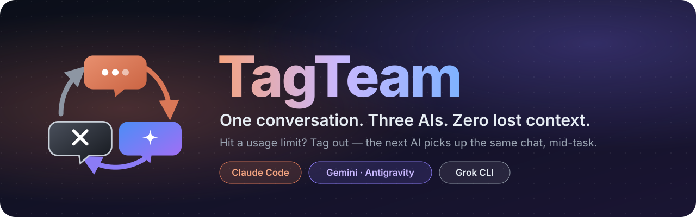
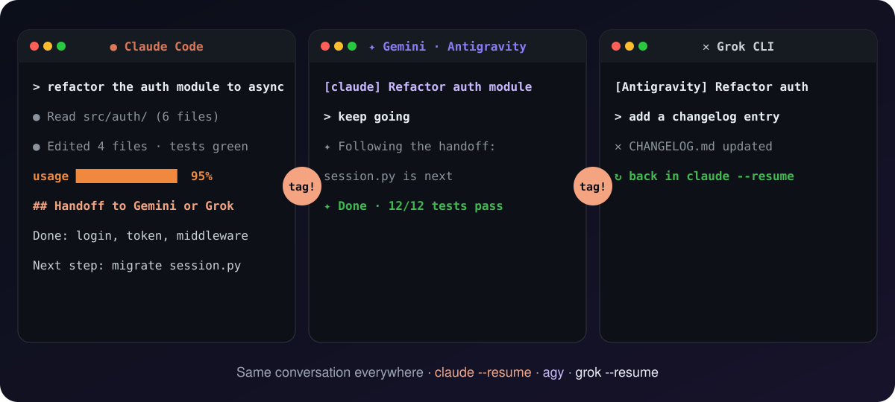
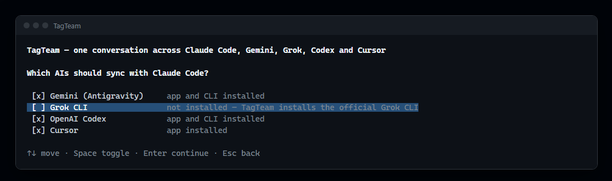
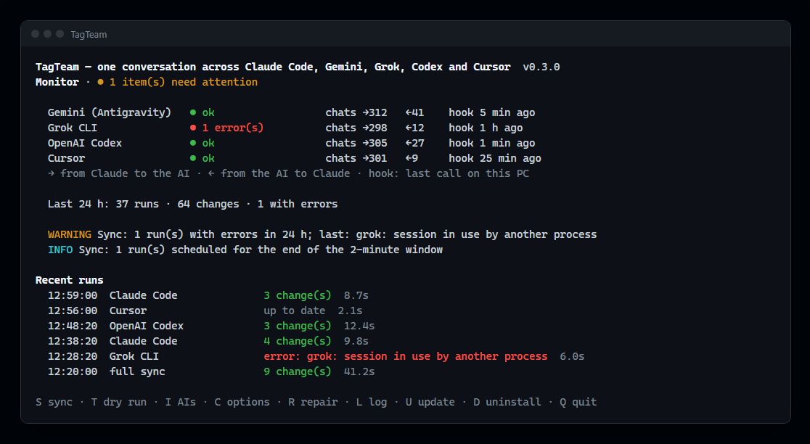
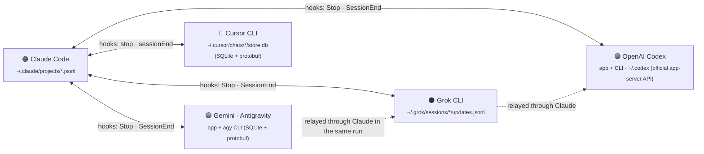

<p align="center">
  
</p>

<h1 align="center">TagTeam — Sync Claude Code, Gemini (Antigravity), Grok CLI, OpenAI Codex &amp; Cursor Conversations</h1>

<p align="center">
  <b>English</b> · <a href="README.pt-BR.md">Português (Brasil)</a> · <a href="https://mop4r.github.io/tagteam/">Project site</a>
</p>

<p align="center">
  <a href="https://github.com/mop4r/tagteam/actions/workflows/tests.yml"></a>
  <a href="LICENSE"></a>
  
  
  
</p>

<p align="center">
  
  
  
  
  
  <a href="https://github.com/mop4r/tagteam/stargazers"></a>
  
</p>

<h3 align="center">Hit a usage limit in the middle of a task? <i>Tag out.</i><br>The next AI picks up the <u>same conversation</u> — history, context and a handoff note included.</h3>

<p align="center">
  
</p>

---

## ✨ Why TagTeam?

You are deep into a refactor with **Claude Code** and the 5-hour limit hits. You open **Gemini** (Antigravity), the
**Grok CLI**, **OpenAI Codex** or **Cursor**… and start from zero, pasting context, re-explaining the task, losing the thread.

**TagTeam makes your conversations travel.** Every Claude Code session shows up in Gemini, Grok, Codex and Cursor — and every
Gemini, Grok, Codex or Cursor session shows up in `claude --resume` (and from there in the others) — automatically, both
ways, with the right title. Close to the
limit, the agent that is about to stop **writes a five-line handoff** so the next one knows exactly where to continue.

> As far as we know, it is the first open-source tool that keeps **one conversation alive across five different
> AI coding agents** — not a chat wrapper, not an API proxy: your real sessions, in each tool's native format.

## 🚀 Features

| | |
|---|---|
| 🔁 **Five-way sync, both directions** | Claude Code ⇄ Gemini (Antigravity app **and** `agy` CLI) ⇄ Grok CLI ⇄ OpenAI Codex (app **and** CLI) ⇄ Cursor CLI (`cursor-agent`), through hooks — no command to remember. |
| ▶️ **Native resume everywhere** | Sessions land in each tool's own storage: `claude --resume`, the Antigravity sidebar, `agy`, `grok --resume`, the Codex app, `codex resume` and `cursor-agent --resume`. |
| 🤝 **Automatic handoff** | At 95% of the Claude limit (or the Gemini quota) a hook makes the agent write *Request / Done / In progress / Next step / Watch out* before stopping. |
| 🧠 **Same brain in every tool** | Gemini and Grok read your `~/.claude/CLAUDE.md`, the same skills, the Claude plugins and your MCP servers — by reference, never copied. Codex too: a generated `AGENTS.md` block, one junction per skill, Claude's plugins installed natively from Claude's own marketplaces, and the same MCP servers. Cursor already reads Claude's skills, `CLAUDE.md` and plugins by itself; TagTeam adds the MCP servers and the hook. |
| 🛡️ **Never clobbers your work** | A conversation continued on the other side is never overwritten: a new version is created and yours stays. Mirrors never bounce back. |
| 💻 **Multi-PC friendly** | Paths from another machine (other user, other drive) are remapped to this one; state is per PC. |
| 🪶 **Zero dependencies** | Pure Python standard library (SQLite, protobuf parsing, TOML) + the official installers of each CLI. |
| 🔒 **Local only** | Nothing leaves your machine. No telemetry, no server, no API keys. |

## ⚡ Quick start

> **Requirements:** Windows 10/11 and [Claude Code](https://claude.com/claude-code). Python 3.11+ (the installer offers
> to install it with winget). The other AIs are optional: TagTeam shows which ones you have and installs the official
> `agy`, Grok and Codex CLIs if you check them.

Paste this in PowerShell:

```powershell
irm https://mop4r.github.io/tagteam/install.ps1 | iex
```

It downloads the latest release (checked against the SHA-256 GitHub publishes for it) and opens the TagTeam setup:

1. **Pick the AIs.** It shows what is installed on your PC; check the ones that should share conversations with Claude Code.
2. **Pick the options.** Default folder, the same Claude environment (CLAUDE.md, skills, plugins, MCP) in each AI, Start
   Menu shortcuts (as admin and without approval prompts only if you say so), the usage status line, the automatic
   handoff and its %, and folders whose conversations must never leave Claude.
3. **Watch it install.** Each step with a ✓ or the reason it failed; then open each CLI once to sign in.

<p align="center"></p>

### The monitor

Open **TagTeam** from the Start Menu (or run it again) and the same program is a **live monitor**: health, chats in
each direction per AI, when each AI's hook last fired, the runs of the last 24 h and any errors. From there you can
sync now, do a dry run, add or remove an AI (one you skipped, or one you installed later), change the options, repair
the setup, open the log, update TagTeam or uninstall it (hooks, shortcuts and generated blocks go; no conversation is
deleted).

<p align="center"></p>

That's it. Start a conversation in any of the five; open another one and it is already there.

<details>
<summary><b>Install with git instead (or without the screens)</b></summary>

```powershell
git clone https://github.com/mop4r/tagteam "$HOME\.claude\skills\tagteam"
python -I "$HOME\.claude\skills\tagteam\scripts\tagteam.py"            # setup + monitor
python -I "$HOME\.claude\skills\tagteam\scripts\tagteam.py" --simples  # numbered prompts, no full screen
python -I "$HOME\.claude\skills\tagteam\scripts\tagteam.py" --status   # print health and exit
python -I "$HOME\.claude\skills\tagteam\scripts\instalar.py" --seco     # what the setup would change
python -I "$HOME\.claude\skills\tagteam\scripts\sincronizar.py" --seco  # what a sync would do
```

Without `~/.tagteam/config.json` TagTeam behaves as before it existed (every AI, shortcuts as admin and without
approval prompts), so an existing install changes nothing until you save options in the monitor.
</details>

## 🧩 How it works



- **Claude Code is the hub.** Each AI syncs with Claude; whatever just arrived from one of them is relayed to the
  others in the same run, so all five converge.
- **Hooks do the work.** Claude Code (`SessionStart`, `Stop`, `SessionEnd`), Antigravity (`Stop`), Grok, Codex and Cursor
  (`Stop`, `SessionEnd`) each call TagTeam after every reply — throttled to once every 2 minutes per conversation, and
  the last reply inside that window is synced when it closes. A sync that finds another one running waits for its turn.
- **Native formats.** Claude JSONL, Antigravity's per-conversation SQLite with protobuf steps (written through its
  local language server when the app is open), Grok's ACP `updates.jsonl` + `chat_history.jsonl`, and Codex through
  its own local API (`codex app-server`) and native session import — the app and the CLI share `~/.codex` — and Cursor's CLI chat store (content-addressed SQLite blobs with protobuf turns).
- **No ping-pong.** Every imported copy carries a marker (`entrypoint`, a `claude_import` table, a
  `claude_import.json`); a copy nobody continued is never sent back. Continued copies spawn a new version instead of
  being overwritten.

Deep dive: [`docs/HOW-IT-WORKS.md`](docs/HOW-IT-WORKS.md).

## 🤝 The handoff

When the Claude Code status line reports ≥ 95% of the 5-hour or 7-day limit (or Antigravity's quota API says the
same for Gemini), the `Stop` hook blocks **once** and the agent writes, as its last message:

```markdown
## Handoff to Gemini or Grok
- Request: migrate the auth module to async.
- Done: login, token and middleware migrated; 34 tests green (commit 3f2a91c).
- In progress: session.py half done, branch feat/async-auth.
- Next step: finish SessionStore.refresh() and run tests/auth.
- Watch out: don't touch the legacy /v1 routes; credentials are in .env.local.
```

The receiving AI is told (by the generated `GEMINI.md` / `AGENTS.md`) to look for it and follow the *Next step*. No
handoff because the limit hit hard? It reconstructs those five lines from the last messages before acting.

Test it without waiting for the limit: `set TAGTEAM_HANDOFF_THRESHOLD=10`.

## 📦 What gets mirrored

| From Claude Code | Gemini (Antigravity / agy) | Grok CLI | OpenAI Codex (app / CLI) |
|---|---|---|---|
| Conversations | ✅ both ways (app + CLI) | ✅ both ways | ✅ both ways (app + CLI) |
| `~/.claude/CLAUDE.md` | ✅ via generated `~/.gemini/GEMINI.md` | ✅ loaded natively + `~/.grok/AGENTS.md` | ✅ via a generated block in `~/.codex/AGENTS.md` |
| Skills (`~/.claude/skills`) | ✅ `config/skills.json` | ✅ native | ✅ one junction per skill in `~/.codex/skills` |
| claude.ai account skills (`~/.claude/skills/synced`) | ✅ `config/skills.json` | ✅ junctions in `~/.grok/skills` (so Claude's docx/pdf/pptx/xlsx win over Grok's built-ins) | ✅ junctions |
| Claude plugins | ✅ skills + Antigravity-ready plugins | ✅ enabled in `config.toml` | ✅ installed natively from Claude's local marketplaces (reinstalled when Claude's version changes) |
| MCP servers (`~/.claude.json`) | ✅ `config/mcp_config.json` | ✅ remote servers in `config.toml` | ✅ `config.toml`, through Codex's config API |
| Automatic handoff at the limit | ✅ (quota API) | ✋ manual — Grok doesn't expose usage outside its TUI | ✋ manual |
| Resume picker shortcut | ✅ "Agy CLI --resume" | ✅ "Grok --resume" | ✅ "Codex --resume" |

**Cursor:** conversations both ways with the `cursor-agent` CLI; Cursor reads `CLAUDE.md`, Claude's skills and enabled
plugins natively, and TagTeam writes `~/.cursor/mcp.json`, the `~/.cursor/hooks.json` hook and the claude.ai skill
junctions. The Cursor **app** works both ways too: its chats are read from its database and reach Claude (and the
others), and Claude's sessions are written into it, so they show up in the app's list and can be continued there with
the full history. The app's own *Import Claude Code Conversations* setting finds nothing on Windows in Cursor 1.1.3 (it
builds the Claude project folder name by replacing only `/` with `-`), so TagTeam does it instead: only while the app is
closed (an open app would overwrite it; the next run catches up), only for folders the app already knows, the 50 most
recent sessions of the last 30 days (like Cursor's own importer), and it stops with a message if a Cursor update
changes the format.

## 🛠️ Manual commands

```powershell
cd "$HOME\.claude\skills\tagteam\scripts"
python -I sincronizar.py                       # sync everything, every direction
python -I sincronizar.py --direcao grok        # Claude -> Grok only   (antigravity | claude | grok | claude-de-grok | codex | claude-de-codex | cursor | claude-de-cursor)
python -I sincronizar.py --sessao <claude-id>  # one Claude session    (--cascade <gemini-id> / --grok <grok-id> / --codex <codex-id> / --cursor <cursor-id>)
python -I sincronizar.py --forcar              # rewrite / recreate deleted copies (never a continued one)
python -m unittest discover -p "test_*.py"     # 160+ tests (the Codex ones run the real Codex in a throwaway folder)
```

| Environment variable | Default | What it does |
|---|---|---|
| `TAGTEAM_HANDOFF_THRESHOLD` | `95` | % of the limit that triggers the handoff (wins over the monitor's option) |
| `TAGTEAM_WORKSPACE` | your home | default working folder (shortcuts, fallback for sessions whose folder doesn't exist here; wins over the monitor's option) |
| `TAGTEAM_STATE_DIR` | `~/.tagteam` | per-PC sync state, `config.json` (the monitor's options) and `eventos-<PC>.jsonl` (one line per run) |

Logs: `%TEMP%\tagteam\sincronizar.log` (each run's output in one block, so parallel runs never mix lines).

## ❓ FAQ

<details><summary><b>Is this affiliated with Anthropic, Google, xAI or OpenAI?</b></summary>

No. TagTeam is an independent community project. It only reads and writes files on your own machine, in the formats
these tools already use.</details>

<details><summary><b>Does it send my conversations anywhere?</b></summary>

No. Everything is local file I/O plus the local servers of Antigravity and Codex. No network calls except the
official CLI installers, when you don't have them yet.</details>

<details><summary><b>Can I use it across several PCs?</b></summary>

Yes. Sync `~/.claude/projects` with whatever you like (git, Syncthing, OneDrive…). On each PC, TagTeam imports the
Claude sessions into that PC's Gemini, Grok and Codex, remapping paths from other users and drives.</details>

<details><summary><b>How do I stop syncing one AI, or uninstall?</b></summary>

Open **TagTeam** (Start Menu) and press **I** to uncheck the AI (or only its chats, or only its environment) and the
setup takes its hook, shortcuts and generated blocks out; press **D** to uninstall everything. The conversations already
copied, and the AIs themselves, stay where they are.</details>

<details><summary><b>What happens if I continue the same chat in two tools?</b></summary>

Nothing is lost. A copy that was continued is never overwritten; the next sync creates a new version next to it.</details>

<details><summary><b>Why are some comments in Portuguese?</b></summary>

TagTeam was born as a personal tool in Brazil. User-facing text is English; code comments are being translated —
PRs welcome.</details>

<details><summary><b>macOS / Linux?</b></summary>

Not yet: the shortcuts, the Grok picker and some paths are Windows-specific. The sync core is portable — help wanted!</details>

## 🗺️ Roadmap

- [x] Claude Code ⇄ Antigravity app + `agy` CLI
- [x] Grok CLI, three-way relay
- [x] Automatic handoff (Claude, Gemini)
- [x] OpenAI Codex (app + CLI), four-way relay
- [x] Cursor CLI, five-way relay
- [ ] macOS and Linux
- [ ] More agents: Gemini CLI, Copilot CLI
- [ ] Optional cleanup command for test conversations

## 🙌 Contributing

Issues and PRs are very welcome — see [CONTRIBUTING.md](CONTRIBUTING.md). If TagTeam saved your flow, a ⭐ helps
other people find it.

## ⭐ Star history

<a href="https://star-history.com/#mop4r/tagteam&Date">
  <picture>
    <source media="(prefers-color-scheme: dark)" srcset="https://api.star-history.com/svg?repos=mop4r/tagteam&type=Date&theme=dark">
    
  </picture>
</a>

## 📄 License

[MIT](LICENSE). Claude, Gemini, Antigravity, Grok, OpenAI and Codex are trademarks of their respective owners; TagTeam is not
endorsed by them.

<p align="center"><sub>Built for people who refuse to lose a train of thought to a rate limit.</sub></p>
