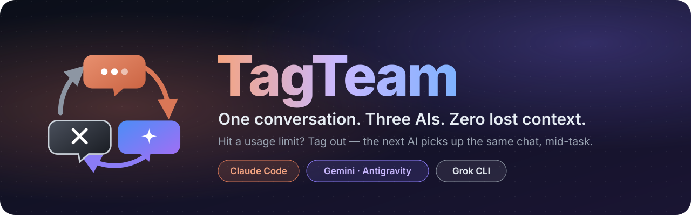
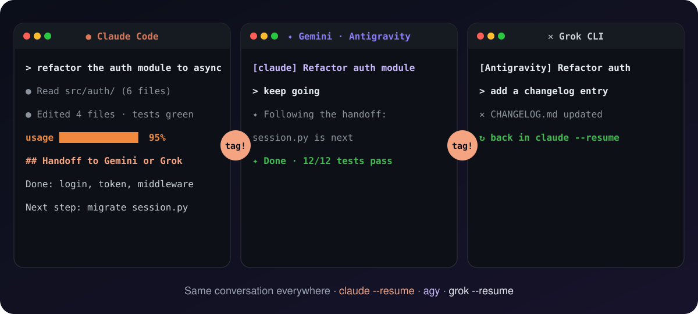

<p align="center">
  
</p>

<h1 align="center">TagTeam — Sincronize conversas entre Claude Code, Gemini (Antigravity), Grok CLI e OpenAI Codex</h1>

<p align="center">
  <a href="README.md">English</a> · <b>Português (Brasil)</b> · <a href="https://mop4r.github.io/tagteam/pt-br/">Site do projeto</a>
</p>

<p align="center">
  <a href="https://github.com/mop4r/tagteam/actions/workflows/tests.yml"></a>
  <a href="LICENSE"></a>
  
  
</p>

<h3 align="center">Bateu o limite no meio da tarefa? <i>Toque a mão.</i><br>A próxima IA continua a <u>mesma conversa</u>, com histórico, contexto e um bilhete de passagem.</h3>

<p align="center">
  
</p>

## ✨ Por quê?

Você está no meio de uma refatoração no **Claude Code** e o limite de 5 horas acaba. Abre o **Gemini** (Antigravity),
o **Grok CLI** ou o **OpenAI Codex**… e começa do zero, colando contexto e explicando tudo de novo.

**Com o TagTeam as conversas viajam.** Toda sessão do Claude Code aparece no Gemini, no Grok e no
Codex, e toda sessão deles aparece no `claude --resume` (e dali nas outras), sozinhas, nos dois sentidos e com o título certo. Perto do limite, a IA que
vai parar **escreve uma passagem de cinco linhas** para a próxima saber exatamente onde continuar.

## 🚀 Recursos

- 🔁 **Sincronização entre as quatro, nos dois sentidos**, por hooks: Claude Code ⇄ Gemini (app **e** CLI `agy`) ⇄ Grok CLI ⇄ OpenAI Codex (app **e** CLI).
- ▶️ **Resume nativo em todas:** `claude --resume`, a lista do Antigravity, `agy`, `grok --resume`, o app do Codex e `codex resume`.
- 🤝 **Passagem automática** a 95% do limite do Claude (ou da cota do Gemini).
- 🧠 **O mesmo cérebro:** Gemini e Grok leem o seu `~/.claude/CLAUDE.md`, as skills, os plugins do Claude e os servidores MCP, por referência; o Codex recebe um bloco no `AGENTS.md` que aponta para as mesmas regras.
- 🛡️ **Nunca sobrescreve trabalho seu:** conversa continuada do outro lado vira versão nova; espelho não volta.
- 💻 **Vários PCs:** caminhos de outra máquina são trocados pelos desta; o estado é por PC.
- 🪶 **Zero dependências** e 🔒 **tudo local**, sem telemetria.

## ⚡ Começando

> **Requisitos:** Windows 10/11, Python 3.11+, [Claude Code](https://claude.com/claude-code). Os apps do Antigravity e do
> Codex são opcionais; o CLI `agy`, o Grok CLI e o CLI do Codex são instalados para você.

```powershell
git clone https://github.com/mop4r/tagteam "$HOME\.claude\skills\tagteam"
python -I "$HOME\.claude\skills\tagteam\scripts\instalar.py"   # pode rodar de novo quando quiser
agy     # login uma vez
grok    # login uma vez
codex   # login uma vez
```

Pronto: comece uma conversa em qualquer uma das quatro e abra outra; ela já está lá.

## 🧩 Como funciona

O Claude Code é o centro: cada IA sincroniza com ele, e o que acabou de chegar de uma segue para as outras na mesma
rodada. O Codex entra pela API local oficial dele (`codex app-server`) e pela importação nativa de sessões; o app e o
CLI do Codex dividem o `~/.codex`. Os hooks de cada ferramenta chamam o TagTeam depois de cada resposta (no máximo uma vez a cada
2 minutos por conversa). Cada cópia importada leva uma marca, e cópia que ninguém continuou nunca volta. Detalhes
(em inglês) em [`docs/HOW-IT-WORKS.md`](docs/HOW-IT-WORKS.md).

## 🤝 A passagem

```markdown
## Handoff to Gemini or Grok
- Request: o que foi pedido, em uma frase.
- Done: o que está pronto e verificado.
- In progress: o que ficou no meio.
- Next step: a primeira ação de quem continuar.
- Watch out: o que não fazer, onde estão as credenciais.
```

Para testar sem esperar o limite: `set TAGTEAM_HANDOFF_THRESHOLD=10`.

## 🙌 Contribua

Issues e PRs são bem-vindos ([CONTRIBUTING.md](CONTRIBUTING.md)). Se o TagTeam salvou o seu fluxo, uma ⭐ ajuda outras
pessoas a acharem.

## 📄 Licença

[MIT](LICENSE). Claude, Gemini, Antigravity, Grok, OpenAI e Codex são marcas dos seus donos; o TagTeam é independente.
